# Mapa de fluxo — App de Gestão Escolar

| Campo | Valor |
|---|---|
| Documento | Mapa de fluxo (navegação, fluxos de usuário e fluxos de sistema) |
| Fonte | *App de Gestão Escolar — Especificação v3* (05/11/2026) |
| Versão deste documento | 1.0 |
| Documentos relacionados | [`PRD.md`](./PRD.md) · [`SRS.md`](./SRS.md) |

> Diagramas em [Mermaid](https://mermaid.js.org/) — renderizam direto no GitHub. Os códigos entre colchetes (ex.: `RF-FIN-07`) apontam para os requisitos do [`SRS.md`](./SRS.md).

## Índice

1. [Mapa geral de navegação](#1-mapa-geral-de-navegação)
2. [Login e roteamento por perfil](#2-login-e-roteamento-por-perfil)
3. [Primeiro acesso do pai e termo LGPD](#3-primeiro-acesso-do-pai-e-termo-lgpd)
4. [Área do pai: escolher filho e página do aluno](#4-área-do-pai-escolher-filho-e-página-do-aluno)
5. [Escola: onboarding da escola](#5-escola-onboarding-da-escola)
6. [Escola: cadastro de aluno, pais, tag e termo](#6-escola-cadastro-de-aluno-pais-tag-e-termo)
7. [Escola: publicar nova versão do termo](#7-escola-publicar-nova-versão-do-termo)
8. [Professor: chamada, notas e comportamento](#8-professor-chamada-notas-e-comportamento)
9. [Agenda: criar evento e confirmar reunião](#9-agenda-criar-evento-e-confirmar-reunião)
10. [Avisos e notificações](#10-avisos-e-notificações)
11. [Justificativa de falta](#11-justificativa-de-falta)
12. [Financeiro: mensalidade e cobrança extra](#12-financeiro-mensalidade-e-cobrança-extra)
13. [Financeiro: pagamento pelo pai e baixa por webhook](#13-financeiro-pagamento-pelo-pai-e-baixa-por-webhook)
14. [Financeiro: lembretes automáticos](#14-financeiro-lembretes-automáticos)
15. [Tag: leitura de entrada e saída](#15-tag-leitura-de-entrada-e-saída)
16. [Tag: leitor offline](#16-tag-leitor-offline)
17. [Tag: aviso de ausência](#17-tag-aviso-de-ausência)
18. [Tag: correção manual e gestão de tags](#18-tag-correção-manual-e-gestão-de-tags)
19. [Ciclos de vida (estados)](#19-ciclos-de-vida-estados)

---

## 1. Mapa geral de navegação

Telas por perfil, conforme a seção 12 da especificação.

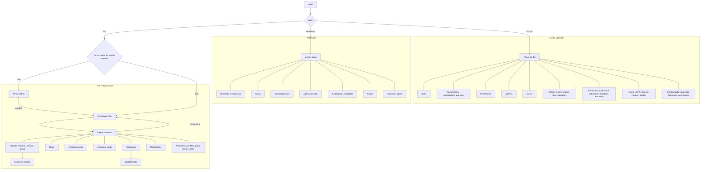

---

## 2. Login e roteamento por perfil

`RF-AUT-01..08`

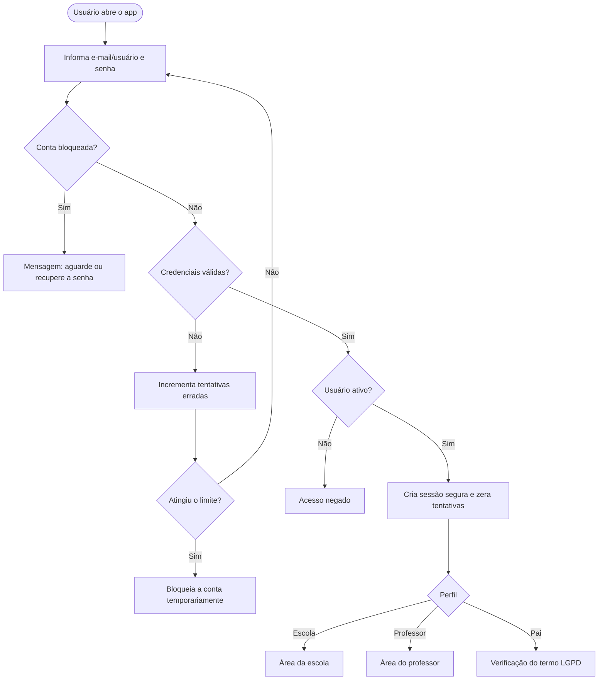

---

## 3. Primeiro acesso do pai e termo LGPD

`RF-LGP-05..07`, `RF-LGP-13`, `RN-03`. O termo aparece **antes de qualquer outra tela**; sem aceite o pai não avança.

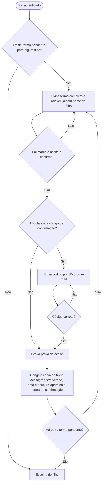

**O que é gravado em cada aceite:** pai e alunos vinculados · versão do termo e cópia do texto · data e hora · IP e aparelho · forma de confirmação · situação (aceito/revogado) e data da revogação.

> Pai com mais de um filho: um termo por filho **ou** termo único listando os filhos — **a definir** pela escola (`RF-LGP-08`).

### 3.1 Revogação do consentimento

`RF-LGP-11`

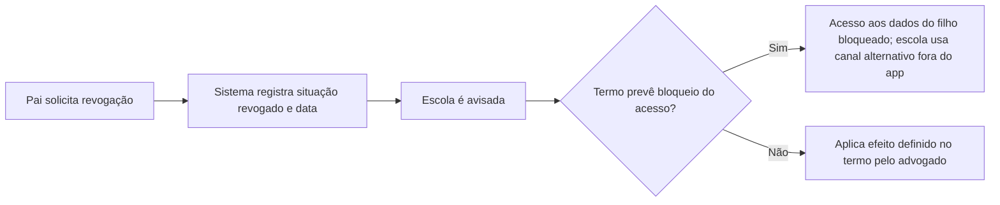

---

## 4. Área do pai: escolher filho e página do aluno

`RF-PAI-01..06`

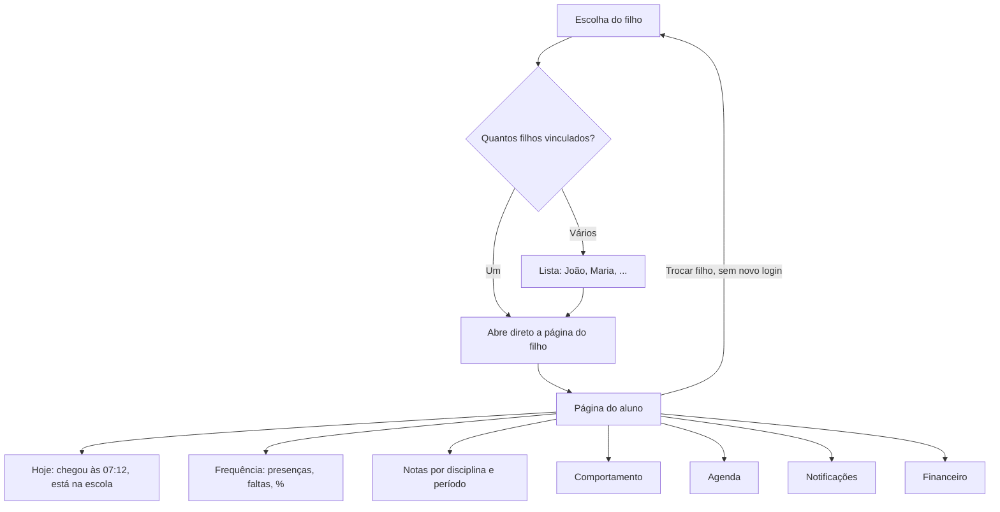

---

## 5. Escola: onboarding da escola

`RF-ESC-12`, `INT-01`. Responsável pelo cadastro da escola (admin da plataforma) — **a definir**.

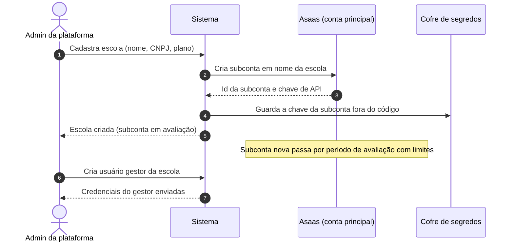

---

## 6. Escola: cadastro de aluno, pais, tag e termo

`RF-ESC-03..06`, `RF-TAG-01`, `RF-LGP-02..04`

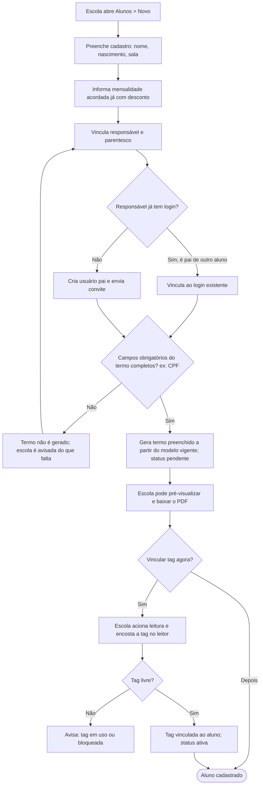

> Mudança posterior nos dados do pai ou do aluno: o termo **pendente** é regenerado; o já **aceito** permanece como estava (`RF-LGP-09`).

---

## 7. Escola: publicar nova versão do termo

`RF-LGP-10`, `RF-LGP-12`

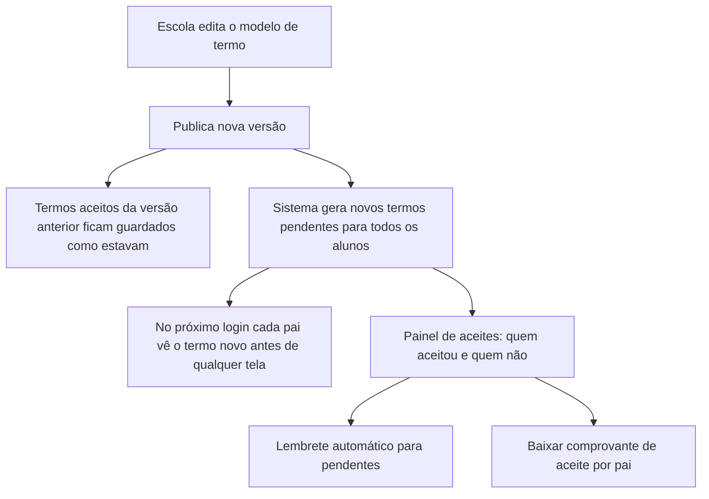

---

## 8. Professor: chamada, notas e comportamento

`RF-PED-01..09`, `RF-TAG-16`

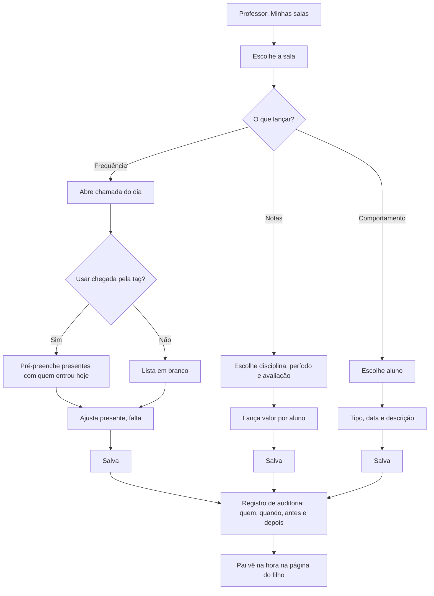

---

## 9. Agenda: criar evento e confirmar reunião

`RF-AGE-01..07`, `RN-12`, `RN-13`

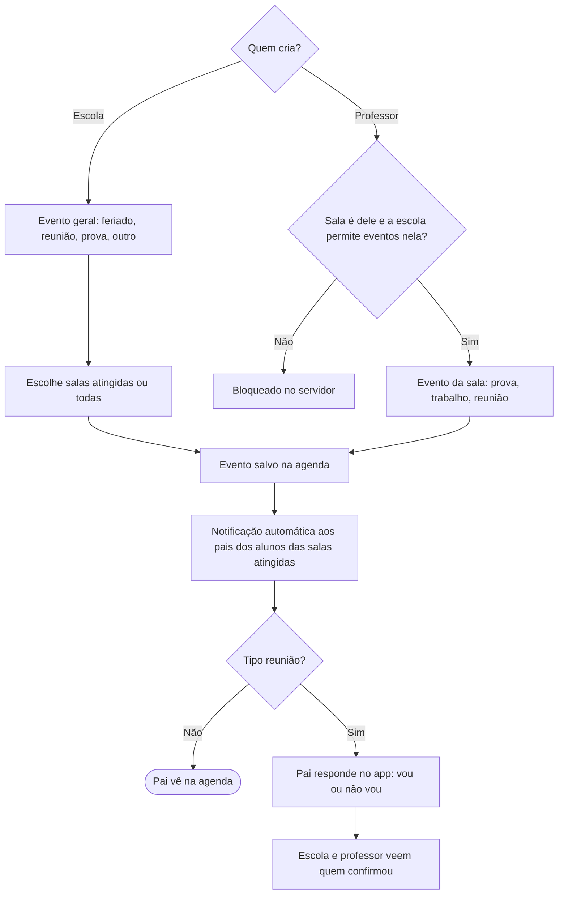

---

## 10. Avisos e notificações

`RF-COM-01..04`, `INT-03`

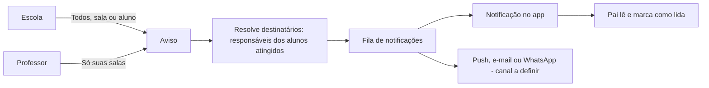

---

## 11. Justificativa de falta

`RF-COM-05..07`

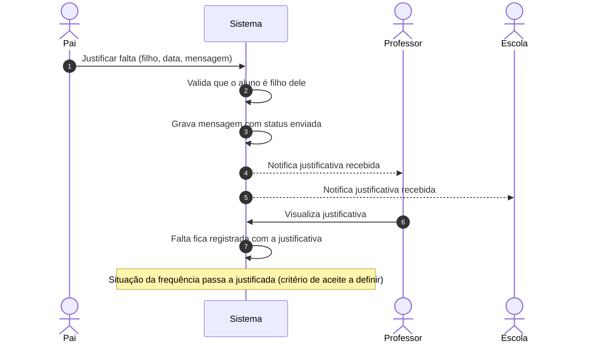

---

## 12. Financeiro: mensalidade e cobrança extra

`RF-FIN-01..05`, `RN-04..07`

### 12.1 Mensalidade

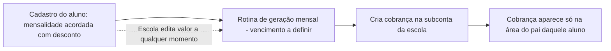

### 12.2 Cobrança extra

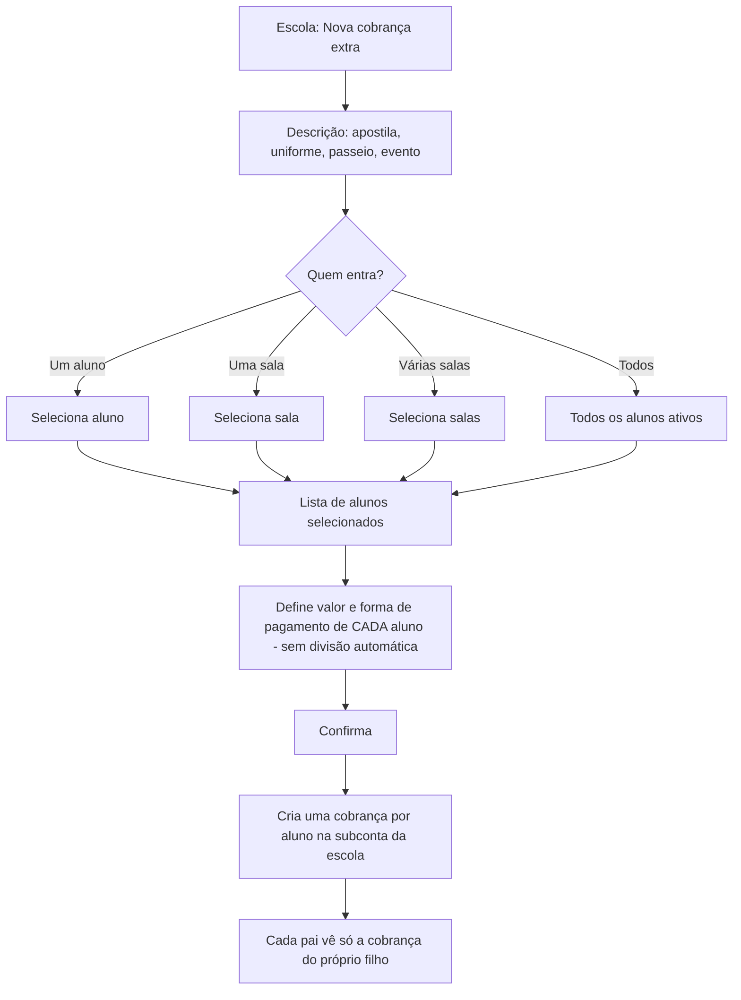

---

## 13. Financeiro: pagamento pelo pai e baixa por webhook

`RF-FIN-06..09`, `RN-08`, `RN-09`, `INT-01`

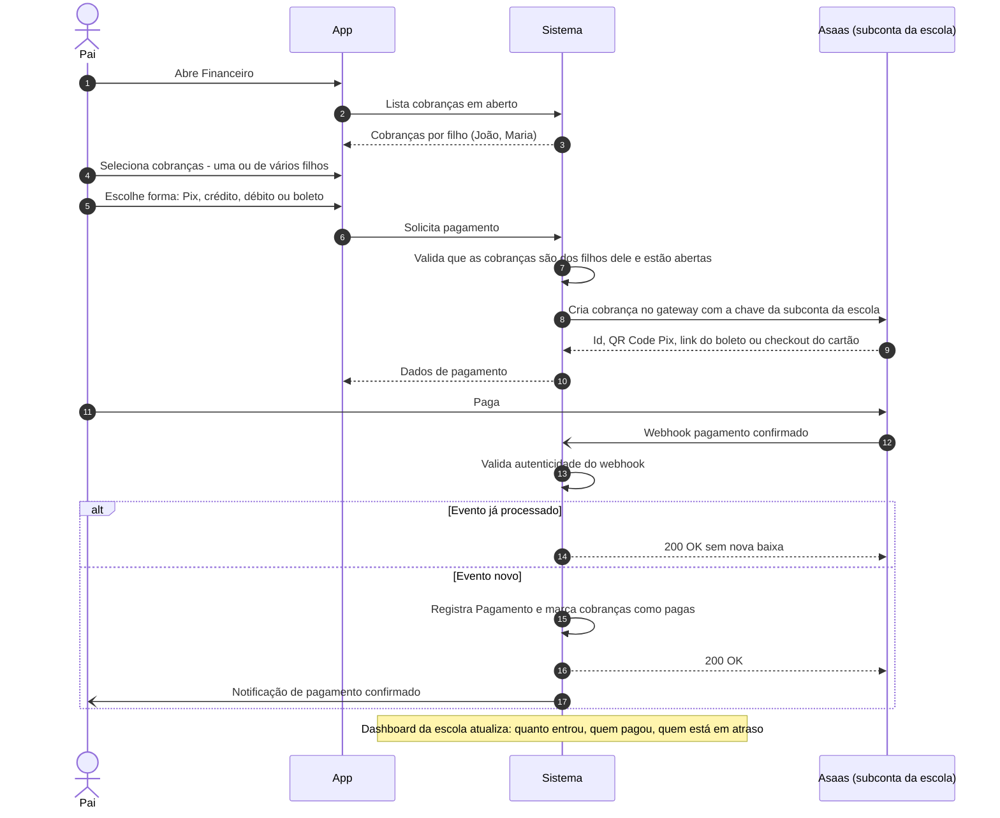

> Detalhe técnico para a fase de arquitetura: como representar "juntar os dois filhos na mesma cobrança" no gateway (cobrança agregada vs. várias cobranças pagas em um checkout).

---

## 14. Financeiro: lembretes automáticos

`RF-FIN-11`, `RF-FIN-12`

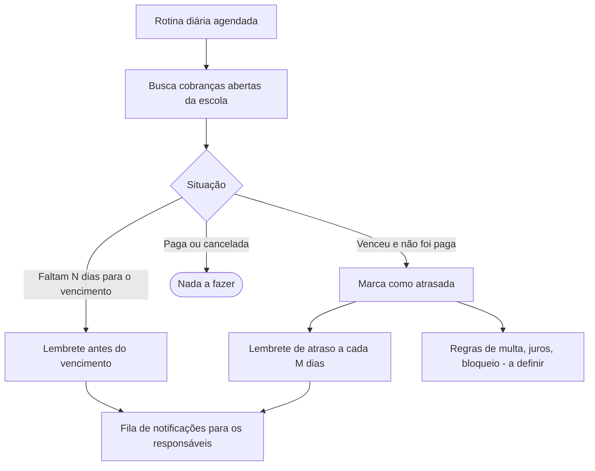

> N e M: **a definir**.

---

## 15. Tag: leitura de entrada e saída

`RF-TAG-04..07`, `RF-TAG-10`, `RF-TAG-12`, `RN-15`, `RN-16`

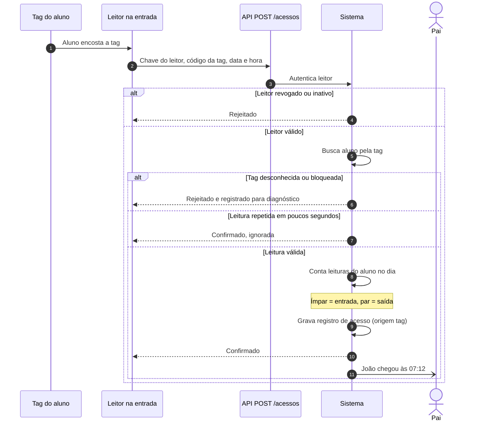

### 15.1 Regra de alternância

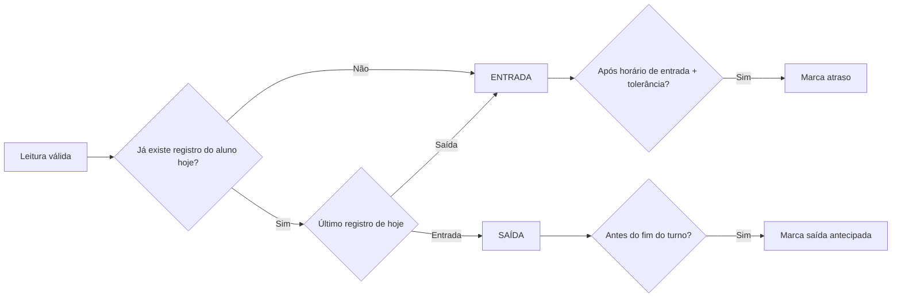

---

## 16. Tag: leitor offline

`RF-TAG-09`, `RNF-CONF-03`

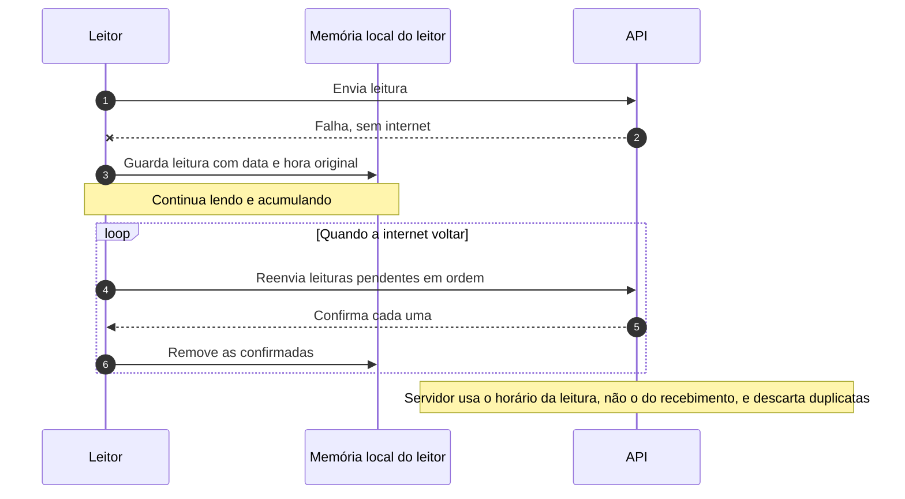

---

## 17. Tag: aviso de ausência

`RN-17`, `RF-TAG-12`, `RF-TAG-13`

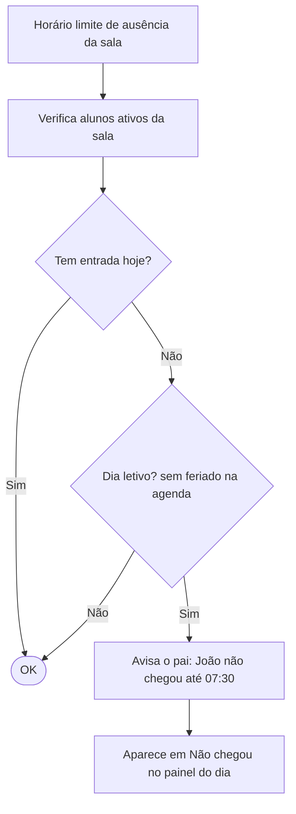

> Ponto de atenção: se um leitor estiver offline, o aviso pode ser falso. Considerar verificar o último contato dos leitores antes de disparar.

---

## 18. Tag: correção manual e gestão de tags

`RF-TAG-02`, `RF-TAG-15`, `RN-19`

```mermaid
flowchart TD
    subgraph CORRECAO["Correção manual de registro"]
        A["Escola abre registro do aluno"] --> B["Inclui, altera ou remove entrada/saída"]
        B --> C{"Informou motivo?"}
        C -->|Não| C1["Bloqueia: motivo obrigatório"]
        C -->|Sim| D["Grava com origem manual, corrigido por e motivo"]
        D --> E["Auditoria"]
    end

    subgraph GESTAO["Gestão de tags"]
        F["Tag perdida"] --> G["Escola bloqueia a tag"]
        G --> H["Vincula nova tag ao aluno"]
        H --> I["Histórico de trocas preservado"]
    end
```

---

## 19. Ciclos de vida (estados)

### 19.1 Cobrança

```mermaid
stateDiagram-v2
    [*] --> Aberta: Cobrança criada no gateway
    Aberta --> Paga: Webhook de pagamento
    Aberta --> Atrasada: Venceu sem pagamento
    Atrasada --> Paga: Webhook de pagamento
    Aberta --> Cancelada: Escola cancela
    Atrasada --> Cancelada: Escola cancela
    Paga --> [*]
    Cancelada --> [*]
```

### 19.2 Tag

```mermaid
stateDiagram-v2
    [*] --> Ativa: Vinculada ao aluno
    Ativa --> Bloqueada: Escola bloqueia
    Ativa --> Perdida: Pai ou escola informa perda
    Bloqueada --> Ativa: Escola desbloqueia
    Perdida --> [*]: Substituída por nova tag
    Bloqueada --> [*]: Substituída por nova tag
```

### 19.3 Termo LGPD

```mermaid
stateDiagram-v2
    [*] --> Pendente: Gerado no cadastro ou nova versão
    Pendente --> Pendente: Dados mudaram, regenerado
    Pendente --> Aceito: Pai aceita
    Pendente --> Substituido: Nova versão publicada
    Aceito --> Substituido: Nova versão publicada
    Aceito --> Revogado: Pai revoga
    Substituido --> [*]
    Revogado --> [*]
```

### 19.4 Justificativa de falta

```mermaid
stateDiagram-v2
    [*] --> Enviada: Pai envia
    Enviada --> Lida: Professor ou escola visualiza
    Lida --> Registrada: Falta passa a justificada
    Registrada --> [*]
    note right of Lida: Valores exatos de status a definir
```

### 19.5 Leitor

```mermaid
stateDiagram-v2
    [*] --> Ativo: Cadastrado com chave de API
    Ativo --> Revogado: Escola revoga a chave
    Revogado --> Ativo: Nova chave gerada
    Ativo --> Inativo: Escola desativa
    Inativo --> Ativo: Escola reativa
```
