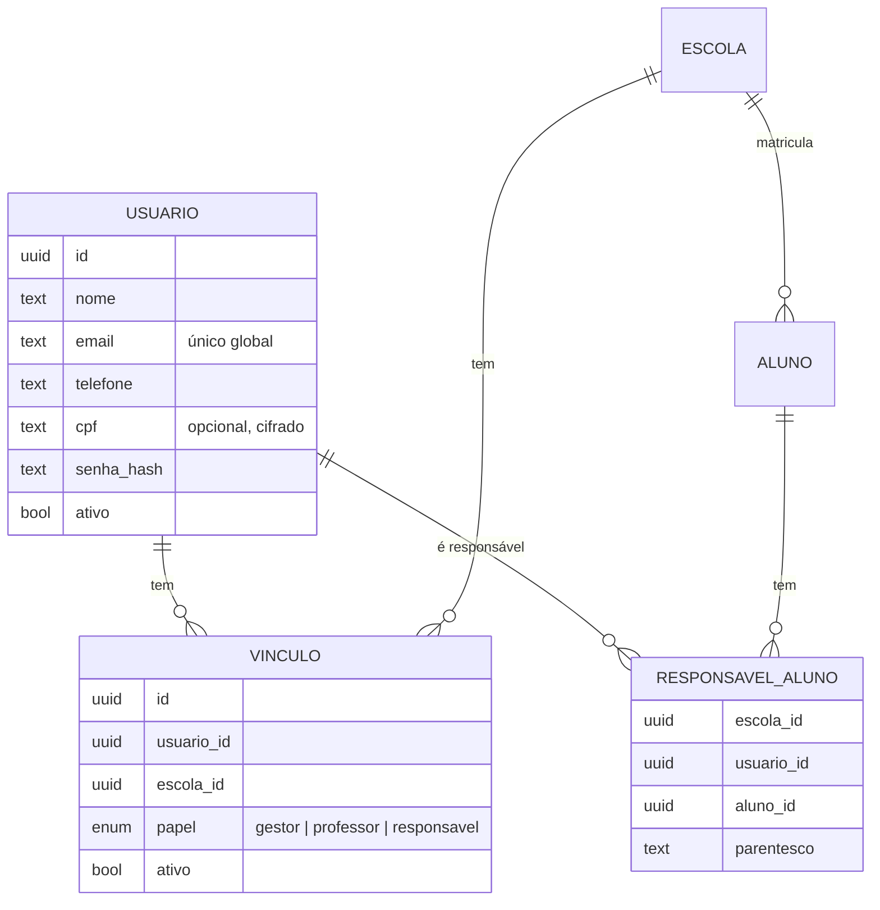

# ADR-003 — Identidade global de usuário e vínculos por escola

| Campo | Valor |
|---|---|
| Status | **Aceita** |
| Data | 07/11/2026 |
| Relacionados | [ADR-001](./ADR-001-multiescola-banco-unico-rls.md) · `RF-AUT-*`, `RF-ESC-06`, `RF-PAI-01`, `RF-FIN-07`, `RF-LGP-13` do [SRS](../SRS.md) |

## Contexto

A especificação original liga cada usuário a uma escola. Decisão do produto: **um pai pode ter filhos em escolas diferentes** que usam o sistema e deve continuar com **um login só**. O mesmo vale, naturalmente, para um professor que leciona em duas escolas ou para um professor que também é pai de aluno.

## Decisão

Separar **pessoa** (global) de **papel numa escola** (por escola).

- **`usuario`** é global (sem `escola_id`): credenciais, nome, contato. Não fica sob a política RLS por escola; o acesso é restrito por políticas próprias (cada usuário só lê o próprio registro; a escola só enxerga os usuários com quem tem vínculo, via `vinculo`).
- **`vinculo`** diz o que a pessoa é em cada escola. Uma pessoa pode ter vários vínculos (inclusive vários papéis na mesma escola).
- **`responsavel_aluno`** continua com `escola_id` e sob RLS.

### Sessão e contexto ativo

1. Login autentica o **usuário** (global).
2. O sistema lista os contextos possíveis a partir dos vínculos ativos.
   - **Pai:** a tela "Escolha do filho" mostra todos os filhos, agrupados por escola. Escolher um filho define o contexto `(escola do filho, papel responsavel)`.
   - **Professor / gestor em mais de uma escola:** escolhe a escola.
   - Um único contexto possível → entra direto.
3. Trocar de filho/escola chama `POST /sessao/contexto`, que **valida o vínculo** e reemite o token com o novo contexto. As rotas de domínio só usam o contexto da sessão (ADR-001).

### Privacidade entre escolas

- A escola B **não pode descobrir** que um e-mail/CPF já existe no sistema nem que a pessoa tem filhos em outra escola.
- Cadastro de responsável pela escola = **convite**: o sistema envia o convite ao e-mail informado. Se já existir conta, o pai vê "Você foi adicionado como responsável de *Fulano* na *Escola B*" e confirma com o próprio login; se não existir, cria a senha. A tela da escola mostra apenas "convite enviado / aceito" nos dois casos.
- A escola **não define nem redefine a senha** do pai; recuperação é sempre pelo próprio pai (e-mail).
- Dados pessoais editados pela escola B (nome, telefone) ficam no vínculo/cadastro daquela escola quando divergirem; o registro global só é alterado pelo próprio usuário. *(Detalhar na modelagem: quais campos são globais e quais são por escola.)*

### Efeitos nas regras de negócio

- **Termo LGPD:** cada escola é controladora independente; o pai aceita o termo **de cada escola** separadamente. O bloqueio por termo pendente vale por escola (pode ver os filhos da escola A enquanto o termo da escola B está pendente).
- **Pagamento conjunto (`RF-FIN-07`):** só entre filhos **da mesma escola**, pois cada escola recebe numa subconta diferente do gateway. Com filhos em escolas diferentes, o app mostra as cobranças agrupadas por escola e cada grupo é pago separadamente.
- **Notificações:** o pai recebe notificações de todas as escolas, identificadas pelo nome da escola e do filho.

## Consequências

- ✅ Atende pai com filhos em escolas diferentes e professor em várias escolas com um login.
- ✅ Nenhuma escola enxerga dados ou a existência de vínculos em outra escola.
- ⚠️ A tabela `usuario` é a única com dados pessoais fora do isolamento por `escola_id`; precisa de políticas e testes próprios.
- ⚠️ Exclusão de dados (LGPD) passa a ser em dois níveis: remover vínculo/dados de uma escola vs. excluir a conta global (quando não houver mais vínculos).
