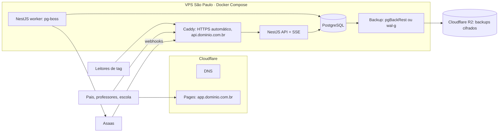

# ADR-004 — Hospedagem: frontend na Cloudflare Pages, backend e banco em VPS em São Paulo

| Campo | Valor |
|---|---|
| Status | **Proposta** (confirmar fornecedor e preços ao contratar) |
| Data | 07/11/2026 |
| Relacionados | [ADR-002](./ADR-002-stack.md) |

## Contexto

- Orçamento inicial de produção: **até R$ 200/mês**, para as primeiras escolas.
- Produção não é imediata; até lá o desenvolvimento roda localmente.
- Dados de menores (LGPD). A LGPD **não obriga** hospedar no Brasil (transferência internacional é permitida com as salvaguardas do art. 33 e da Resolução CD/ANPD nº 19/2024), mas manter os dados no país simplifica o termo, a conversa com as escolas e vira argumento de venda ("dados hospedados no Brasil").
- Leitores de tag e pais estão no Brasil: menor latência com servidor em São Paulo.

## Decisão

### Frontend — Cloudflare Pages (plano gratuito)
- SPA estática (build do Vite) servida por CDN com pontos de presença no Brasil.
- O plano gratuito permite uso comercial (diferente do plano Hobby da Vercel, que é só para uso não comercial).
- Arquivos estáticos não contêm dados pessoais — localização irrelevante para LGPD.
- Também hospeda o **protótipo navegável da fase 0** (dados simulados) sem custo.

### Backend + banco — uma VPS em São Paulo com Docker Compose

- **Perfil da VPS:** 2 vCPU, 4–8 GB RAM, 50+ GB SSD, Ubuntu LTS. Folgado para dezenas de escolas pequenas.
- **Fornecedores com datacenter em São Paulo** (escolher na contratação):
  | Fornecedor | Cobrança | Observação |
  |---|---|---|
  | **Hostinger VPS** (recomendado para começar) | Em reais | Bom custo; promoções exigem contrato longo e a renovação é mais cara |
  | Magalu Cloud | Em reais | Nuvem brasileira |
  | Vultr / AWS Lightsail | Em dólar | Boa reputação; preço sujeito ao câmbio |
- **Domínio:** `.com.br` no registro.br, DNS na Cloudflare. Front e API no mesmo domínio raiz (`app.` e `api.`) para cookies de sessão e CORS simples.
- **Backups:** dump diário + arquivamento contínuo (WAL) com pgBackRest ou wal-g, **cifrados**, enviados ao Cloudflare R2 (10 GB grátis). Teste de restauração mensal agendado.
- **Segredos** (chaves das subcontas Asaas, chaves de leitores): cifrados na aplicação com chave-mestra fora do banco (variável de ambiente/arquivo protegido na VPS); evolui para um cofre gerenciado quando houver orçamento.
- **E-mail transacional:** Resend ou Amazon SES (plano gratuito / centavos por mil no início).
- **Observabilidade:** Sentry (plano gratuito) para erros; Uptime Kuma ou plano gratuito de monitor de disponibilidade.
- **Deploy:** GitHub Actions → build das imagens → `docker compose pull && up -d` na VPS via SSH; migrações Drizzle rodando como passo do deploy.

## Estimativa de custo mensal (valores aproximados — conferir no momento da contratação)

| Item | Custo/mês |
|---|---|
| VPS São Paulo (2 vCPU, 8 GB) | R$ 50 – 100 |
| Cloudflare Pages + DNS | R$ 0 |
| Backups no R2 (até 10 GB) | R$ 0 |
| Domínio `.com.br` (~R$ 40/ano) | ~R$ 4 |
| E-mail transacional | R$ 0 – 10 |
| Sentry / monitoramento | R$ 0 |
| **Total** | **~R$ 55 – 115** |

Sobra margem para o canal de notificação pago (WhatsApp Business é cobrado por conversa) e para crescer a VPS.

## Alternativas descartadas

- **Hetzner / Contabo:** mais baratos, mas sem datacenter no Brasil.
- **Railway / Render / Fly.io:** praticidade, mas custo cresce rápido com banco gerenciado e sem região no Brasil (ou com oferta limitada).
- **Banco gerenciado (RDS, Supabase, Neon):** ótimo para operação, mas sozinho consumiria boa parte do orçamento; reavaliar quando houver receita.
- **Oracle Cloud Free Tier (São Paulo):** gratuito, mas sem garantia de capacidade nem de continuidade da conta — aceitável só para *staging*, não para produção.

## Consequências e riscos

- ⚠️ **Ponto único de falha:** API e banco na mesma máquina. Aceito nesta fase; mitigado por backups contínuos fora da VPS e procedimento de restauração documentado. Primeiro upgrade quando houver receita: banco gerenciado ou segunda VPS.
- ⚠️ Operação (atualizações de segurança, firewall, SSH só por chave, fail2ban) é responsabilidade do desenvolvedor — criar checklist de hardening.
- ✅ Migração simples: tudo em containers; trocar de fornecedor é restaurar backup e apontar o DNS.

## Ambientes

| Ambiente | Onde | Quando |
|---|---|---|
| Desenvolvimento | Local, Docker Compose (PostgreSQL) | Desde já |
| Protótipo (fase 0) | Cloudflare Pages, dados simulados | Validação com escola |
| Staging | Mesma VPS (compose separado) ou Oracle Free Tier | Antes da escola piloto |
| Produção | VPS São Paulo | Escola piloto (fase 6) |
