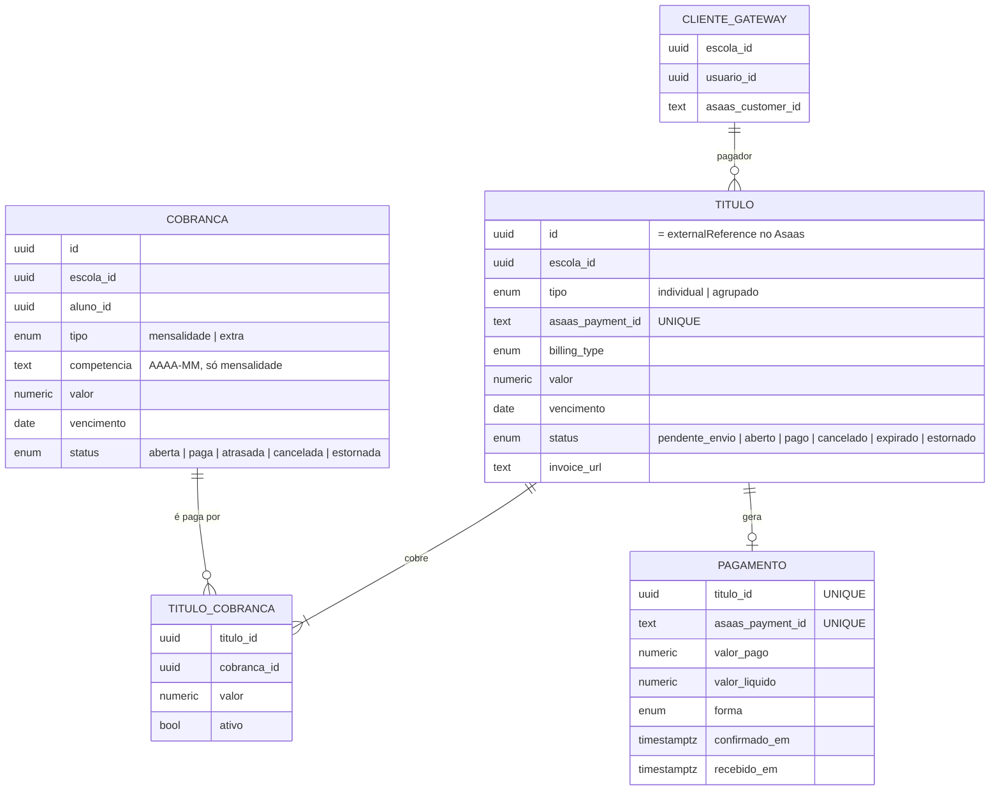
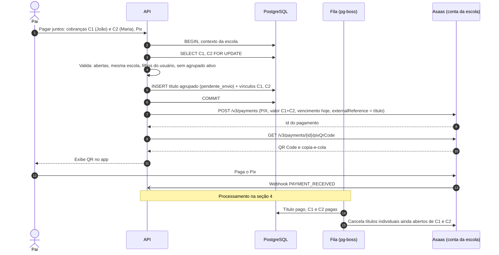
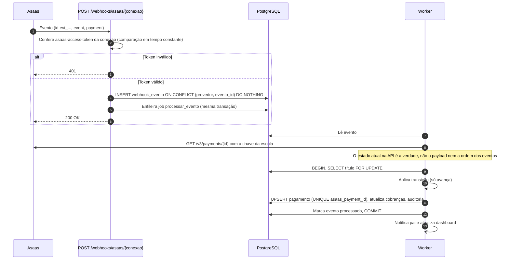

# ADR-005 — Pagamentos no Asaas: pagamento conjunto e webhooks idempotentes

| Campo | Valor |
|---|---|
| Status | **Proposta** (pontos a confirmar no fim do documento) |
| Data | 07/11/2026 |
| Relacionados | [ADR-001](./ADR-001-multiescola-banco-unico-rls.md) · [ADR-002](./ADR-002-stack.md) · [ADR-003](./ADR-003-identidade-global-e-vinculos.md) · `RF-FIN-*`, `RN-07..09`, `INT-01`, `T-04`, `T-05`, `T-08` do [SRS](../SRS.md) |

## Contexto

- Cada escola recebe numa conta própria no Asaas; o dinheiro nunca passa pela plataforma (`RN-07`).
- O pai pode pagar a cobrança de um filho ou juntar as de vários filhos **da mesma escola** num único pagamento (`RF-FIN-07`, ADR-003).
- Pagamento duplicado e baixa dupla são inaceitáveis (`RNF-CONF-01`, `RN-08`).

### Fatos da API do Asaas (conferidos em [docs.asaas.com](https://docs.asaas.com) em 07/11/2026)

| Tema | O que a documentação diz | Impacto |
|---|---|---|
| Webhook — autenticação | Header `asaas-access-token` com o `authToken` configurado (32–255 caracteres). IPs de produção publicados. | Validar token por escola; allowlist de IP opcional |
| Webhook — entrega | "Pelo menos uma vez": o mesmo evento pode chegar repetido, com o mesmo `id` (`evt_...`). A ordem não é garantida. | Deduplicar por `id`; não depender da ordem |
| Webhook — falhas | Após **15 falhas consecutivas** a fila pode ser interrompida; eventos ficam retidos por **14 dias** e depois são excluídos. | Responder 200 rápido; nunca falhar por evento/campo desconhecido; monitorar a fila |
| Recomendação oficial | Gravar o `id` com `UNIQUE`, responder 200 após persistir, processar em background | Adotado como está |
| `PAYMENT_CONFIRMED` × `PAYMENT_RECEIVED` | CONFIRMED = pago, saldo ainda não disponível (cartão: RECEIVED ~32 dias depois). RECEIVED = valor disponível. Pix vai direto para RECEIVED. | Para o pai e a escola, CONFIRMED já é "paga" |
| Criação de cobrança | `billingType`: `UNDEFINED`, `BOLETO`, `CREDIT_CARD`, `PIX`. **`DEBIT_CARD` não é aceito na criação.** Sem header de idempotência. Filtro por `externalReference` na listagem. | Débito precisa ser confirmado; idempotência de criação feita por nós |
| Pix | `GET /v3/payments/{id}/pixQrCode` → imagem base64, copia-e-cola, expiração | QR exibido dentro do app |
| Estorno | `POST /v3/payments/{id}/refund` para cartão e Pix (total/parcial); boleto tem endpoint próprio | Tratamento de duplicidade |
| Cliente | `POST /v3/customers` exige `name` e `cpfCnpj`; cobrança exige `customer` | CPF do responsável financeiro obrigatório |
| Subcontas | Resposta da criação traz `apiKey` e `walletId` — "deve ser capturada nesse momento". Webhooks podem ser configurados na criação. Conta principal precisa ser **PJ**. **Período de avaliação: até 10 subcontas, até R$ 2.000 em cobranças por subconta, máx. 60 dias.** Gerenciar chaves depois exige operação BaaS ou CNPJ de mesma raiz. | Risco alto para o go-live (ver "Riscos") |
| Split | `split[]` com `walletId`, `fixedValue`/`percentualValue` na criação da cobrança | Viabiliza cobrar a mensalidade do sistema no futuro |

## Decisão

### 1. Separar **cobrança** (negócio) de **título** (instrumento no gateway)

- **Cobrança** é a verdade do negócio (o que o aluno deve). **Título** é a cobrança criada no Asaas (boleto/Pix/cartão). Normalmente 1 cobrança ↔ 1 título individual; no pagamento conjunto, 1 título agrupado ↔ N cobranças.
- O dashboard da escola e a área do pai leem **cobranças**; títulos são detalhe de pagamento.
- O pagador no Asaas é o **responsável financeiro** do aluno (novo campo por aluno), cadastrado como `customer` na conta da escola (`CLIENTE_GATEWAY`). Qualquer responsável vinculado pode pagar pelo app; o título sai em nome do responsável financeiro.

### 2. Idempotência na **saída** (nós → Asaas)

- **Geração de mensalidades:** `UNIQUE (escola_id, aluno_id, tipo, competencia)` — rodar a rotina duas vezes não gera cobrança dupla.
- **Criação de título:**
  1. Grava `TITULO` com `status = pendente_envio` (o `id` dele vai como `externalReference`).
  2. Chama `POST /v3/payments`.
  3. Sucesso → grava `asaas_payment_id`, `status = aberto`.
  4. Timeout/erro de rede → **antes de tentar de novo**, consulta `GET /v3/payments?externalReference={titulo.id}`; se existir, adota; se não, recria.
  - Executado como job do pg-boss com retentativas (backoff).

### 3. Pagamento conjunto (título agrupado)

Regras:
- Só cobranças **abertas ou atrasadas**, **da mesma escola** e de **filhos do usuário**.
- Formas: **Pix** (QR no app) e **cartão de crédito** (página de pagamento do Asaas). **Boleto não** — tem compensação lenta e o pai pode pagar o boleto individual antigo no mesmo período.
- Vencimento = hoje; o título agrupado **expira no fim do dia** se não for pago (job cancela no Asaas e libera as cobranças).
- Uma cobrança só pode estar em **um título agrupado ativo** por vez (índice único parcial em `TITULO_COBRANCA (cobranca_id) WHERE ativo AND tipo = 'agrupado'`).
- Os títulos individuais **continuam válidos** enquanto o agrupado estiver aberto (não se apagam boletos que o pai talvez já tenha em mãos). Quando o agrupado é pago, os individuais em aberto são **cancelados** no Asaas.

### 4. Idempotência na **entrada** (webhooks)

- **Um endpoint por conexão de escola** (`/webhooks/asaas/{conexaoId}`), cada uma com `authToken` próprio, guardado como hash. Allowlist dos IPs publicados do Asaas no Caddy como camada extra (opcional, os IPs podem mudar).
- **Nunca devolver erro por conteúdo**: evento ou campo desconhecido é gravado e ignorado com 200. Só se responde erro se não conseguir persistir (banco fora). Isso evita a interrupção da fila após 15 falhas.
- **Gatilho, não verdade:** o worker consulta o pagamento na API antes de agir. Eventos fora de ordem ou repetidos convergem para o mesmo estado.
- **Baixa única:** `PAGAMENTO.asaas_payment_id` é `UNIQUE`; transições de título só avançam.

#### Mapeamento de eventos

| Evento Asaas | Efeito no título | Efeito nas cobranças |
|---|---|---|
| `PAYMENT_CREATED`, `PAYMENT_UPDATED`, `PAYMENT_BANK_SLIP_VIEWED`, `PAYMENT_CHECKOUT_VIEWED` | Atualiza dados | — |
| `PAYMENT_CONFIRMED` | `pago` (registra `confirmado_em`) | `paga` — pai vê "pago" |
| `PAYMENT_RECEIVED` | `pago` (registra `recebido_em`) | `paga` (idempotente se já estava) |
| `PAYMENT_OVERDUE` | — | Informativo; o status `atrasada` é calculado por nós pelo vencimento |
| `PAYMENT_CREDIT_CARD_CAPTURE_REFUSED`, `PAYMENT_REPROVED_BY_RISK_ANALYSIS` | Continua `aberto` | Avisa o pai para tentar outra forma |
| `PAYMENT_DELETED` | `cancelado` | Se não fomos nós que cancelamos → alerta para a escola (excluído pelo painel do Asaas) |
| `PAYMENT_RESTORED` | `aberto` | Reabre |
| `PAYMENT_REFUNDED`, `PAYMENT_PARTIALLY_REFUNDED` | `estornado` | `estornada` / reaberta + alerta para a escola |
| `PAYMENT_RECEIVED_IN_CASH_UNDONE` | `aberto` | Reabre |
| `PAYMENT_CHARGEBACK_*` | Marca disputa | Alerta para a escola |
| Demais | Grava e ignora | — |

### 5. Pagamento em duplicidade

Pode acontecer (raro): o pai paga o título agrupado e, no mesmo intervalo, um boleto individual.
- O worker detecta cobrança que ficaria paga por **dois títulos**: o segundo pagamento é registrado normalmente (o dinheiro entrou) e a cobrança gera um **alerta de duplicidade** no dashboard da escola.
- A escola decide com um clique: **estornar** (Pix/cartão via `refund`; boleto via endpoint de estorno de boleto) ou **manter como crédito** para a próxima mensalidade.

### 6. Reconciliação e monitoramento

- **Reconciliação diária por escola:** lista no Asaas os pagamentos com alteração recente e compara com os títulos locais; corrige divergências pelo mesmo processamento do webhook (eventos "sintéticos").
- **Saúde da fila:** alerta se uma escola com títulos abertos ficar mais de X horas sem nenhum webhook; e-mail de "fila interrompida" do Asaas configurado para o e-mail técnico da plataforma.
- **Expiração:** job encerra títulos agrupados não pagos ao fim do dia.

### 7. Conexão da escola com o Asaas

- O módulo de pagamento depende só de **credenciais por escola** (`apiKey`, `walletId`, `authToken` do webhook), cifradas (ADR-004). Isso permite os dois modelos sem mudar o resto do sistema:
  - **A — Subconta criada pela plataforma** (decisão da especificação). Fluxo: grava registro local `criando` → `POST /v3/accounts` com `webhooks` já configurados → grava `apiKey` cifrada **na mesma operação** (a chave só é garantida na resposta da criação). Falha entre a criação e a gravação → registro fica `criando` e entra numa lista de recuperação manual.
  - **B — Conta própria da escola conectada:** a escola abre a conta no Asaas e cola a chave de API nas configurações; a plataforma registra o webhook nessa conta via API.
- **Mensalidade do sistema** (futuro): `split` com o `walletId` da conta da plataforma em cada cobrança, ou cobrança mensal à parte.

### 8. Formas de pagamento na interface

| Forma | Experiência |
|---|---|
| Pix | QR Code e copia-e-cola dentro do app |
| Boleto | Linha digitável e PDF (link do Asaas) — só para título individual |
| Cartão de crédito | Página de pagamento do Asaas (`invoiceUrl`); dados de cartão nunca passam pelo nosso servidor (fora do escopo PCI) |
| Cartão de débito | **Não suportado na criação via API** — confirmar com o Asaas se é possível pela página de pagamento; senão, retirar do escopo |

## Consequências

- ✅ Nenhuma baixa dupla: dedupe por evento, estado consultado na API, `UNIQUE` no pagamento, transições monotônicas.
- ✅ Pagamento conjunto sem apagar boletos que o pai já tenha em mãos.
- ✅ Webhooks perdidos são recuperados pela reconciliação.
- ⚠️ Mais estados para testar (título agrupado expirado, duplicidade, estorno, chargeback).
- ⚠️ Taxas do Asaas por transação saem da conta da escola — deixar claro na venda.

## Riscos

| Risco | Impacto | Ação |
|---|---|---|
| **Período de avaliação** das subcontas: R$ 2.000 em cobranças por subconta, até 10 subcontas, até 60 dias | Uma escola com 100 alunos fatura muito mais que R$ 2.000/mês — **não dá para operar** sem liberação | Conversar com o gerente de contas do Asaas antes da escola piloto; se não houver liberação, usar o modelo B (conta própria da escola) |
| Conta principal precisa ser PJ | Bloqueia o modelo A sem CNPJ | Abrir CNPJ (avaliar com contador) ou usar modelo B |
| Perda da `apiKey` de uma subconta | Escola sem cobrança; regenerar pode exigir BaaS | Gravação atômica e cifrada; backup do cofre |
| Cartão de débito indisponível | Requisito da especificação não atendido | Confirmar com o Asaas |

## Pontos a confirmar

1. Pagamento conjunto apenas por **Pix e cartão de crédito** (sem boleto)?
2. Duplicidade: a escola escolhe **estornar ou manter como crédito** (proposta) — ou estorno automático?
3. **Responsável financeiro** por aluno: quem a escola indica no cadastro (padrão: primeiro responsável vinculado)?
4. **Cartão de débito:** manter no escopo só se o Asaas suportar.
5. **Modelo A ou B** de conta da escola — depende da conversa com o Asaas sobre o período de avaliação.
6. Notificações de cobrança do próprio Asaas (e-mail/SMS ao cliente): desligar e usar só os lembretes do app, ou aproveitar o e-mail do Asaas — decidir junto com a decisão 3 (canal de notificações).
